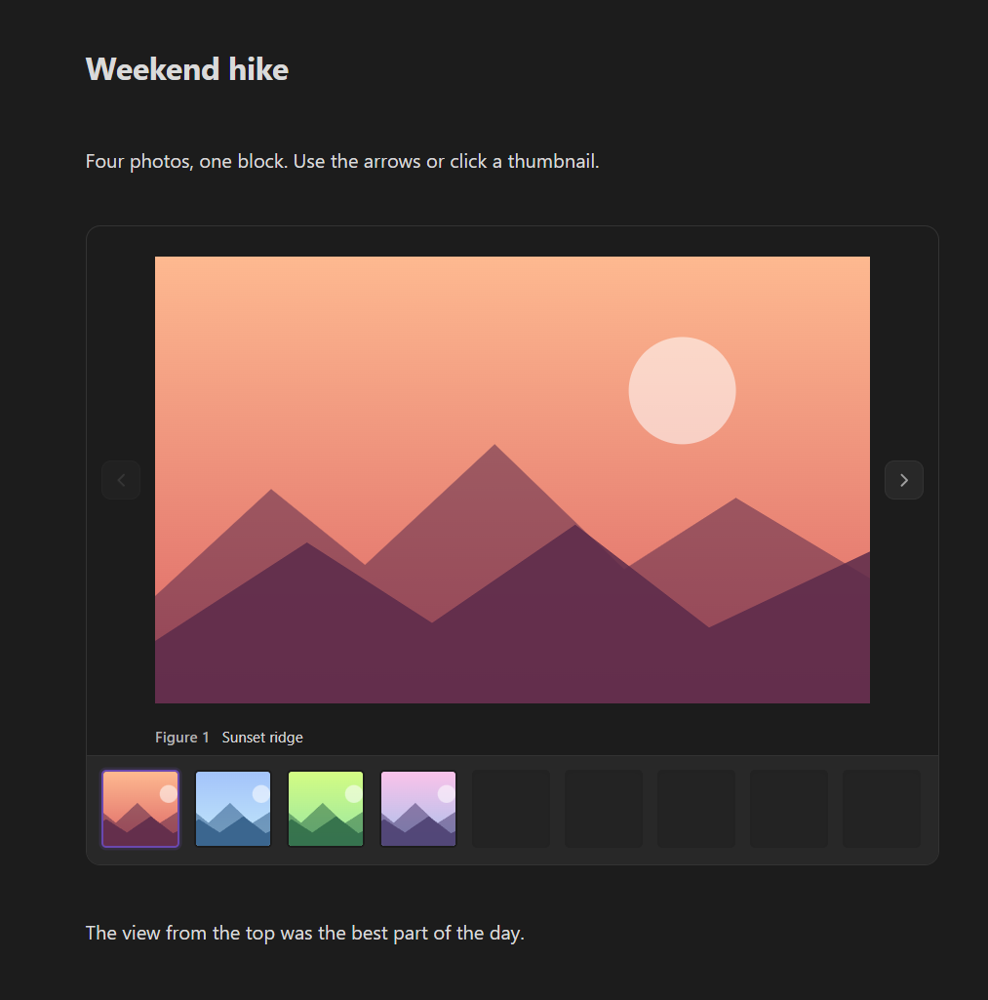

# Paipa Gallery

**Put a whole set of photos or videos into one tidy, swipeable block instead of a long column of images.**



## Is this for you?

- You drop ten trip photos into a note and suddenly have to scroll forever.
- You write reports, papers or project logs and want **Figure 1, Figure 2…** with captions, and references in your text that jump to the right image.
- You want to reorder images by dragging thumbnails, not by moving `![[...]]` lines around.
- Your vault has big camera photos and pages with images feel sluggish.

## What you get

- **One block, many images and videos**: arrows / arrow keys to browse, click the main image to open the original.
- **Thumbnails you can drag** to reorder. Drag a thumbnail out to place it in the note, or drag an image from the note or your file manager into the gallery.
- **Figures and captions**: every item is numbered (`Figure N`). Double-click to write a caption; numbering follows the order automatically.
- **Figure references**: right-click a thumbnail → **Insert reference** puts a small button in your text that scrolls to that figure.
- **Video player**: play / pause, seek, volume, playback speed.
- **Fast with large photos**: thumbnails and the main view use small copies made on the fly; the full file loads only when you open it.

## Quick start

1. Select a few image or video links in a note.
2. Right-click → **Gallery** (or run **Create gallery**).
3. That's it. Drag thumbnails to reorder, double-click `Figure 1` to add a caption.

Coming from Lite Gallery? Put the cursor in a `litegal` block and run **Convert Lite Gallery at cursor**.

## Your data

A gallery is a fenced code block with a small JSON list of your images:

````markdown
```gallery-view
{"v":1,"id":"gal-hike","images":[{"id":"a","link":"![[ridge.jpg]]","caption":"Sunset ridge"}]}
```
````

Your images stay normal files in your vault. Without the plugin you see the code block, and the files are untouched.

## Works on

Windows, macOS, Linux, iPhone / iPad and Android. On touch screens, tap a thumbnail to select it and long-press to drag.

## Works well with

All optional.

- [Editor Enhancer](https://github.com/Paipa03/obsidian-editor-enhancer): drag the whole gallery like any other block.
- [Section Blocks](https://github.com/Paipa03/obsidian-section-blocks): files dropped into a gallery are saved in a `<note name> media` folder next to the note. Without it, Obsidian's own attachment setting decides where they go.

## Notes

- Some tooltips and messages are currently in Chinese.
- UI inspired by Lite Gallery.

## Install

**Settings → Community plugins → Browse**, search **Paipa Gallery**, then Install and Enable.

## License

MIT
