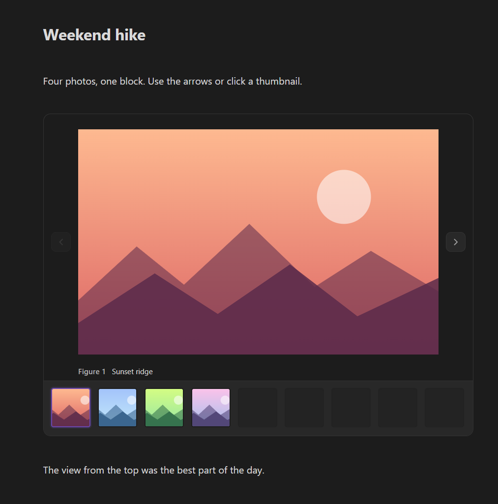

# Paipa Gallery

**Many images and videos in one tidy, swipeable block — instead of a long column of pictures.**



## Features

- **Browse**: arrows or ← / → to step through; click the main image for the full-size viewer, which has its own arrows and keeps the same size while you page.
- **Zoom in the viewer**: Ctrl + scroll (or pinch on a trackpad) zooms around the pointer, drag to pan. Zoom snaps at the fitted size.
- **On phones**: the viewer is just the picture. Swipe to the next / previous image with a sliding animation, pinch to zoom, drag to pan, tap outside the picture to close.
- **Reorder by dragging thumbnails.** Drag a thumbnail out to put the image back in the note; drag images in from the note or your file manager.
- **Figures and captions**: items are numbered `Figure 1, 2…` automatically. Double-click the label to add a caption.
- **Any note image in the viewer** (optional): turn it on in settings and images outside galleries open in the same viewer when clicked (tap on phones), showing the file name.
- **Viewer to tab** (desktop): drag the strip at the top of the viewer like a tab, onto a tab bar, a pane edge or out of the window, to keep the image open in its own tab, split or window. The tab looks like the viewer and zooms the same way (Ctrl + scroll, drag to pan).
- **Search captions** (desktop): the search icon in a gallery's top-left corner finds figures by caption across all galleries in the note and jumps to the one you pick.
- **Figure references**: right-click a thumbnail → **Insert reference** adds a button at the end of the gallery's section (above the next heading) that jumps to that figure. Numbers update when you reorder. The same menu has **Show in system explorer**.
- **Videos** (mp4, webm, mov…): play / pause, seek, volume, speed.
- **Fast with large photos, originals untouched**: the block shows small copies, kept on this device between sessions; the viewer shows one at once and switches to the original as soon as it loads.
- **Safe to edit from outside**: changes made to the note by another app, a script or Sync show up while the note is open. Accidentally deleting a whole gallery in the editor is blocked.

## Quick start

1. Select some image or video links in a note.
2. Right-click → **Gallery**, or run the command **Create gallery**.
3. Drag thumbnails to reorder; double-click `Figure 1` to add a caption.

Coming from Lite Gallery? Put the cursor in a `litegal` block and run **Convert Lite Gallery at cursor**.

## Settings

| Setting | What it does |
|---|---|
| **Gallery behaviour for note images** (off by default) | Images outside galleries open in the same viewer when clicked (tap on phones), show a magnifier pointer, and drag like a tab. When off, they behave exactly as in Obsidian. |
| **Fill the viewer frame** (off by default) | The full-size viewer fills its frame with every image, enlarging small ones. Display only. |
| **Shrink large images when adding** (off by default) | Replaces files: large images dropped into a gallery are saved at the size the viewer needs on your largest screen (shown in the setting), and only the smaller copy is kept. JPG, PNG and WebP only. Phones never re-encode: images added there are shrunk the next time a desktop shows the gallery. |
| **Keep previews on this device** (on by default) | Keeps the gallery's thumbnails and main images in the app's own storage (outside the vault, never synced), with a size limit and a Clear button; removed when the plugin is uninstalled. |
| **Language** | Follow Obsidian, English or 中文. |

Command **Downscale images in this note's galleries** shrinks large images already in the note's galleries to the same size. It asks first, then **overwrites the original files** (other notes embedding them change too).

## Your data

A gallery is a fenced code block holding a small JSON list:

````markdown
```gallery-view
{"v":1,"id":"gal-hike","images":[{"id":"a","link":"![[ridge.jpg]]","caption":"Sunset ridge"}]}
```
````

Images stay ordinary files in your vault. Without the plugin you just see the code block.

## Works on

Desktop, iPhone / iPad and Android. On touch screens: tap a thumbnail to select, long-press to drag; in the viewer, swipe and pinch.

## Works well with (optional)

- [Editor Enhancer](https://github.com/Paipa03/obsidian-editor-enhancer): drag the whole gallery like any other block.
- [Section Blocks](https://github.com/Paipa03/obsidian-section-blocks): dropped files go to a `<note name> media` folder next to the note.

## Install

**Settings → Community plugins → Browse**, search **Paipa Gallery**, Install, Enable.

[Changelog](CHANGELOG.md) · MIT License · UI inspired by Lite Gallery.
